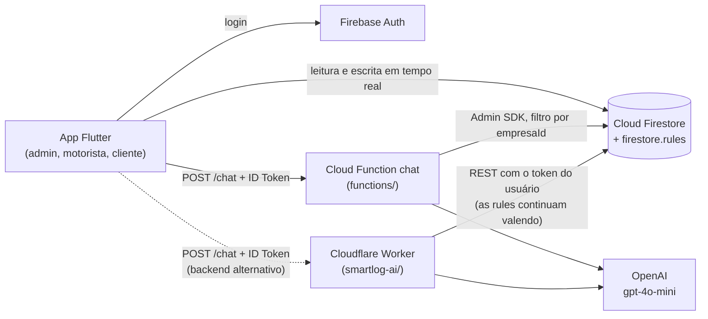

# SmartLog

> **Projeto em equipe — fork de [LucasSilva2005/Smartlog](https://github.com/LucasSilva2005/Smartlog).**
> O núcleo do app Flutter (autenticação, painel do administrador, telas do motorista, leitura de QR Code, rastreamento e mapas) é trabalho de **Lucas da Silva**. Abaixo está o que eu desenvolvi.

### Minha contribuição (Deyvid Gondim)

- **Camada de IA (Assistente Logístico)** — Cloudflare Worker em [`smartlog-ai/`](smartlog-ai/) que recebe a pergunta do app, **verifica o Firebase ID Token (JWT) via WebCrypto** contra as chaves públicas do Google, lê o Firestore com a credencial do próprio usuário e responde com a OpenAI. A identidade, o perfil e a empresa vêm só do token verificado, nunca do corpo da requisição.
- **Seleção de contexto e relevância** — normalização dos schemas de `entregas` gravados por caminhos diferentes do app, contexto recortado por perfil (admin, motorista, cliente) e seleção das entregas guiada pela pergunta (códigos `ENT-…`, nomes, regiões), com teto de itens para controlar custo de tokens ([`contexto.js`](smartlog-ai/src/contexto.js), [`relevancia.js`](smartlog-ai/src/relevancia.js)).
- **Cloud Functions** — a mesma lógica portada para uma Firebase Function HTTP (`chat`, `southamerica-east1`) com Admin SDK e chave da OpenAI no Secret Manager, que é o backend usado hoje pelo app ([`functions/`](functions/)).
- **Regras de segurança do Firestore** — isolamento multi-tenant por `empresaId` e permissões por perfil em [`firestore.rules`](firestore.rules).
- **No app Flutter** — tela do chat assistente ([`chat_assistente.dart`](lib/screens/chat_assistente.dart)), `ChatController`/`ChatService` e o painel do cliente ([`cliente.dart`](lib/screens/cliente.dart)).
- **Testes da camada de IA** — 36 testes unitários de normalização, contexto e relevância, mais 4 testes de endpoint no runtime do Worker.

---

## O que é

SmartLog é um app Android de gestão logística **multiempresa**. Cada empresa (tenant) tem três perfis:

| Perfil | O que faz no app |
|---|---|
| **Administrador** | Painel com indicadores da operação; cadastro de entregas, rotas, motoristas e clientes; geração de rota por região; mapa com a posição do motorista em movimento; perfil da empresa. |
| **Motorista** | Rota do dia e lista de entregas, leitura de QR Code para dar baixa (Pendente → A Caminho → Entregue, com nome do recebedor), mapa das paradas, histórico e perfil com foto. |
| **Cliente** | Acompanhamento das próprias entregas em tempo real: status, endereço e motorista responsável. |

Existe também uma tela de rastreio ([`rastreamento.dart`](lib/screens/rastreamento.dart)) que mostra no mapa a localização atual do motorista de uma rota; ela ainda não está ligada à navegação do app.

Os três perfis têm acesso ao **Assistente Logístico**, um chat com IA que responde perguntas sobre a operação ("quais entregas estão atrasadas?", "qual o status da ENT-A8F3?") usando só os dados que aquele usuário pode ver.

## Arquitetura



Fluxo do assistente: o app envia a pergunta com o ID Token no header `Authorization` → o backend valida o token e lê o cadastro do usuário (`usuarios/{uid}`) → monta o contexto só com os dados da empresa e do perfil dele → seleciona as entregas relevantes para a pergunta → chama a OpenAI com um prompt que proíbe inventar dados → devolve a resposta ao app.

Os dois backends têm o mesmo contrato (`POST /chat`). O app aponta hoje para a Cloud Function ([`lib/services/chat_service.dart`](lib/services/chat_service.dart)); trocar para o Worker é mudar a `baseUrl`. A pasta [`worker/`](worker/) guarda o primeiro protótipo do Worker, em que o contexto vinha do cliente, e foi substituída por `smartlog-ai/`.

## Stack

- **App:** Flutter / Dart, Provider, Material 3, `google_maps_flutter`, `geolocator`, `mobile_scanner` (QR Code), `image_picker`
- **Firebase:** Authentication, Cloud Firestore, Storage, Cloud Functions v2 (Node 24, `firebase-admin`, `openai`)
- **IA:** Cloudflare Workers (Wrangler, WebCrypto para JWT, Firestore REST) + OpenAI Chat Completions
- **Testes:** Vitest, `@cloudflare/vitest-pool-workers`, `flutter_test`

## Estrutura

```
lib/                 App Flutter
  controllers/       AuthController, DashboardController, ChatController
  screens/           login, cadastro, dashboard_admin, motorista, cliente,
                     rastreamento, chat_assistente
  services/          auth, chat, maps (ViaCEP), routing
functions/           Cloud Function "chat" (backend do assistente em uso)
smartlog-ai/         Cloudflare Worker do assistente (JWT + Firestore REST)
worker/              Protótipo antigo do Worker
firestore.rules      Regras de segurança do Firestore
test/                Testes do app Flutter
```

## Como rodar

### App Flutter

Pré-requisitos: Flutter SDK (Dart ≥ 3.3) e um emulador ou aparelho Android. O projeto Firebase (`smartlog-b9b37`) já está configurado em `android/app/google-services.json` e `lib/firebase_options.dart`.

```bash
flutter pub get
flutter run
```

Para testar o fluxo completo: cadastre-se como **Administrador** (isso cria a empresa), cadastre um motorista e um cliente no painel, crie entregas/rotas e entre com as outras contas.

### Cloud Functions

```bash
cd functions
npm install
firebase functions:secrets:set OPENAI_API_KEY   # chave fica no Secret Manager
npm run serve                                     # emulador local
npm run deploy                                    # publica a função "chat"
```

As regras do Firestore são publicadas com `firebase deploy --only firestore:rules`.

### Assistente no Cloudflare Worker (`smartlog-ai/`)

```bash
cd smartlog-ai
npm ci
cp .dev.vars.example .dev.vars   # preencha OPENAI_API_KEY (arquivo ignorado pelo git)
npm run dev                      # wrangler dev
```

Em produção a chave vai como secret: `npx wrangler secret put OPENAI_API_KEY` e depois `npm run deploy`.

## Testes

```bash
# Camada de IA (smartlog-ai/)
cd smartlog-ai
npx vitest run          # 36 testes de função pura (Node): normalização, contexto, relevância
npm run test:workers    # 4 testes de endpoint no runtime do Worker (404, 405, 204 CORS, 401 sem token)

# App Flutter (raiz)
flutter test
```

## Observações

- O pacote Dart ainda se chama `smartlife` e o `applicationId` Android é `com.example.smartlife`, herança do projeto que serviu de base. O ID precisa continuar igual ao registrado no Firebase (`google-services.json`), por isso não foi renomeado.
- O CORS dos backends do assistente está aberto durante o MVP. A proteção real é o Bearer token.
